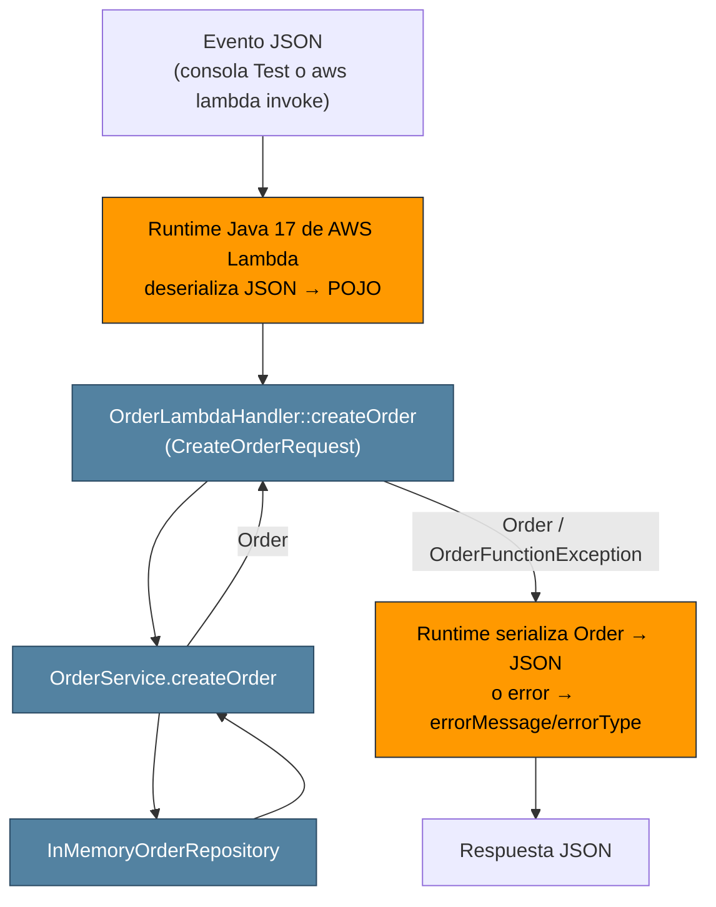
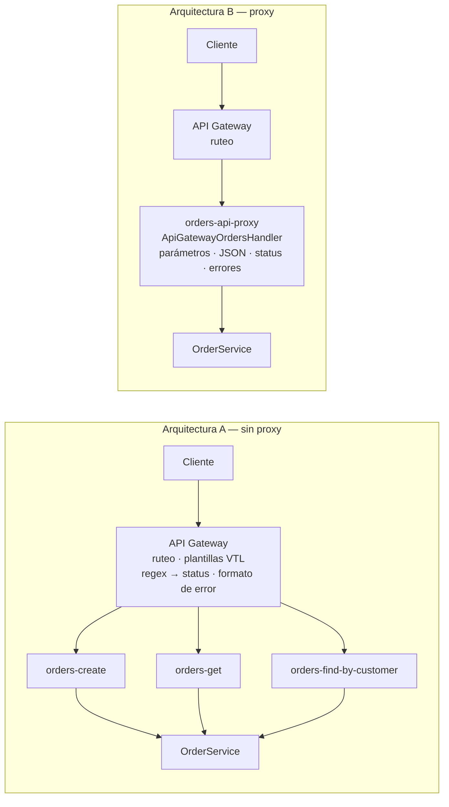

# Orders API — API REST serverless con AWS Lambda y API Gateway

Workshop de diseño de una API REST serverless con **Java 17**, **Maven**, **AWS Lambda**, **Amazon API Gateway** y **JUnit 5**, desarrollada con apoyo de un asistente de IA.

La pregunta que guía todo el trabajo es: **¿dónde debe vivir cada responsabilidad?** (API Gateway, adaptador HTTP en Lambda o lógica de aplicación).

---

## Contenido

1. [Estructura del repositorio](#estructura-del-repositorio)
2. [Cómo construir y probar](#cómo-construir-y-probar)
3. [Fase 1 — Diseño de la API](#fase-1--diseño-de-la-api)
4. [Fase 2 — Aplicación en Java puro](#fase-2--aplicación-en-java-puro)
5. [Fase 3 — Despliegue en AWS Lambda](#fase-3--despliegue-en-aws-lambda)
6. [Fase 4 — Arquitectura A: API Gateway con mapping templates](#fase-4--arquitectura-a-api-gateway-con-mapping-templates)
7. [Fase 5 — Arquitectura B: integración proxy y adaptador HTTP](#fase-5--arquitectura-b-integración-proxy-y-adaptador-http)
8. [Fase 6 — Comparación de arquitecturas](#fase-6--comparación-de-arquitecturas)
9. [Uso del asistente de IA](#uso-del-asistente-de-ia)
10. [Crítica a las decisiones del agente](#crítica-a-las-decisiones-del-agente)
11. [Bitácora de decisiones del agente](#bitácora-de-decisiones-del-agente)
12. [Fase 7 — Extensión DELETE](#fase-7--extensión-delete)
13. [Arquitectura final](#arquitectura-final)
14. [Video de demostración](#video-de-demostración)

---

## Estructura del repositorio

```
orders-api/
├── pom.xml
├── README.md
├── PREDICTION-DELETE.md              (Fase 7)
├── apigateway/
│   ├── nonproxy/
│   │   ├── templates/*.vtl           plantillas de la arquitectura A
│   │   ├── openapi-export.json
│   │   └── README-config.md
│   └── proxy/
│       └── openapi-export.json
├── events/
│   ├── lambda-direct/*.json          eventos de invocación directa (Fase 3)
│   └── proxy/*.json                  eventos reales de API Gateway (Fase 5)
├── examples/
│   ├── nonproxy-requests.md
│   └── proxy-requests.md
├── docs/img/                         capturas de pantalla
└── src/
    ├── main/java/co/edu/escuelaing/
    │   ├── model/        Order, CreateOrderRequest                  ← Java puro
    │   ├── repository/   OrderRepository, InMemoryOrderRepository   ← Java puro
    │   ├── service/      OrderService + excepciones de dominio      ← Java puro
    │   ├── lambda/       handlers de la arquitectura A (sin dependencias AWS)
    │   └── http/         adaptador HTTP de la arquitectura B (depende de AWS)
    └── test/java/co/edu/escuelaing/...
```

## Cómo construir y probar

Requisitos: JDK 17, Maven 3.8+.

```bash
mvn test        # ejecuta todas las pruebas unitarias (no requiere AWS)
mvn package     # genera target/orders-api-1.0.0.jar (fat JAR con dependencias)
```

`mvn package` genera dos archivos:

| Archivo | Contenido | Uso |
|---|---|---|
| `target/orders-api-1.0.0.jar` | Código + dependencias (shade) | **Se sube a Lambda** |
| `target/original-orders-api-1.0.0.jar` | Solo el código del proyecto | Referencia |

---

## Fase 1 — Diseño de la API

### Contrato

| Operación | Método y URL | Parámetros | Body de entrada | Éxito | Errores |
|---|---|---|---|---|---|
| Crear orden | `POST /orders` | — | `{customerId, product, quantity}` | **201 Created** + orden creada + header `Location` | 400 `VALIDATION_ERROR`, 415 `UNSUPPORTED_MEDIA_TYPE`, 500 `INTERNAL_ERROR` |
| Consultar orden | `GET /orders/{id}` | path: `id` | — | **200 OK** + orden | 404 `ORDER_NOT_FOUND`, 500 |
| Buscar por cliente | `GET /orders?customerId={c}` | query: `customerId` | — | **200 OK** + lista (puede ser `[]`) | 400 si falta `customerId`, 500 |
| Eliminar orden *(Fase 7)* | `DELETE /orders/{id}` | path: `id` | — | **204 No Content** (sin body) | 404 `ORDER_NOT_FOUND`, 500 |

### Formato de error

Todas las respuestas de error usan la misma representación:

```json
{
  "error": "ORDER_NOT_FOUND",
  "message": "Order ORD-999 does not exist"
}
```

| Código | Status HTTP | Cuándo |
|---|---|---|
| `VALIDATION_ERROR` | 400 | Entrada inválida o incompleta |
| `ORDER_NOT_FOUND` | 404 | La orden no existe |
| `UNSUPPORTED_MEDIA_TYPE` | 415 | El body no es `application/json` (arquitectura B) |
| `INTERNAL_ERROR` | 500 | Error inesperado; el detalle solo queda en CloudWatch |

### Preguntas de diseño

- **¿Cuáles son los recursos?** La colección `/orders` y cada orden individual `/orders/{id}`.
- **¿Por qué `/orders/{id}`?** El id identifica a un recurso concreto, así que forma parte de su dirección (URI). La URL nombra *una cosa*.
- **¿Por qué `customerId` es un query parameter?** No identifica un recurso: **filtra** la colección `/orders`. Es opcional y combinable con otros filtros (por ejemplo `?customerId=X&product=Y`).
- **¿Qué devuelve `POST /orders`?** `201 Created`, la representación de la orden con el id generado por el servidor y el header `Location` apuntando al nuevo recurso.
- **¿Qué devuelve la API si la orden no existe?** `404 Not Found` con el JSON de error. En cambio, una búsqueda por cliente sin resultados **no** es 404: es `200` con `[]`, porque la colección existe aunque el filtro no encuentre nada.
- **¿Qué contiene un error?** Un código estable y legible por máquina (`error`), para que el cliente pueda tomar decisiones, y un mensaje legible por humanos (`message`). No incluye stack traces ni detalles internos.

---

## Fase 2 — Aplicación en Java puro

La lógica de aplicación no depende de HTTP, API Gateway, Spring Boot ni de un servidor web.

| Paquete | Responsabilidad |
|---|---|
| `model` | `Order` y `CreateOrderRequest`: POJOs con constructor vacío y getters/setters |
| `repository` | `OrderRepository` (interfaz) e `InMemoryOrderRepository` (con datos de ejemplo ORD-001 a ORD-003) |
| `service` | `OrderService`: validación y casos de uso. Comunica fallos con excepciones de dominio (`ValidationException`, `OrderNotFoundException`), **no con status codes** |

`CreateOrderRequest.quantity` es `Integer` (no `int`) para distinguir "no enviado" (`null`) de `0`.


### Checkpoint 1

- **¿Se puede probar la funcionalidad sin AWS?** Sí. Las pruebas se ejecutan con `mvn test` en la máquina local.
- **¿Requiere un servidor web?** No. Son clases Java que se invocan directamente.
- **¿Requiere Spring Boot?** No. No hay ningún framework, solo Java estándar.
- **¿Qué contiene el JAR generado?** Las clases compiladas de `co.edu.escuelaing.*` y los metadatos de Maven en `META-INF`. En esta fase no incluía dependencias, porque JUnit tiene scope `test` (captura 4).
- **¿Qué partes conocen HTTP?** Ninguna. Las excepciones de dominio se traducen a 400/404 más adelante, en otra capa.

---

## Fase 3 — Despliegue en AWS Lambda

Se agregó una capa delgada (`lambda/OrderLambdaHandler`) sin cambiar la lógica de aplicación. El handler:

- construye `OrderService` una vez por entorno de ejecución;
- recibe POJOs simples;
- traduce excepciones de dominio a un mensaje con formato `"CODIGO: descripción"` (por ejemplo `ORDER_NOT_FOUND: Order ORD-999 does not exist`), que luego usa API Gateway en la arquitectura A.

No implementa ninguna interfaz de AWS: Lambda invoca los métodos con el formato `Clase::metodo`.

| Función | Handler |
|---|---|
| `orders-create` | `co.edu.escuelaing.lambda.OrderLambdaHandler::createOrder` |
| `orders-get` | `co.edu.escuelaing.lambda.OrderLambdaHandler::getOrder` |
| `orders-find-by-customer` | `co.edu.escuelaing.lambda.OrderLambdaHandler::findOrdersByCustomer` |

Configuración: Java 17, x86_64, 512 MB, timeout de 15 s. Los eventos de prueba están en `events/lambda-direct/`.


### Hallazgo: las funciones no comparten memoria

Se creó `ORD-004` en `orders-create` y luego se consultó en `orders-get`: el resultado fue `ORDER_NOT_FOUND`. Cada función tiene sus propios entornos de ejecución, con su propia memoria. Además, un nuevo cold start reinicia los datos. **La memoria de Lambda no es almacenamiento persistente**; por eso existen los datos de ejemplo ORD-001 a ORD-003.


### Investigación: ¿cómo convierte Lambda JSON ↔ Java?

**Experimentos realizados sobre `orders-create`:**

| Experimento | Evento | Resultado observado | ¿Quién responde? |
|---|---|---|---|
| A. Campo desconocido | `{"customerId":"CUST-1","product":"X","quantity":1,"color":"red"}` | Ignora `color` y crea la orden | Runtime (lo ignora) |
| B. Número como string | `{"customerId":"CUST-1","product":"X","quantity":"2"}` | Convierte `"2"` en el `Integer` 2 y crea la orden | Runtime (convierte) |
| C. Tipo incompatible | `{"customerId":"CUST-1","product":"X","quantity":"abc"}` | Falla **antes** de llegar al método: `errorType: java.lang.RuntimeException`, `errorMessage: "An error occurred during JSON parsing"`, `stackTrace` vacío | **Runtime** |
| D. Campo omitido | `{"customerId":"CUST-1","product":"X"}` | `quantity` llega como `null` y la aplicación responde `VALIDATION_ERROR: quantity is required` | **Mi código** |
| E. Mayúsculas distintas | `{"CustomerId":"CUST-1","product":"X","quantity":1}` | Distingue mayúsculas: `CustomerId` no se asigna a `customerId`, que llega `null`, y la aplicación responde `VALIDATION_ERROR: customerId is required` | Runtime (no mapea) + mi código (valida) |


**Lo que explicó el asistente:**

1. El runtime recibe el evento como bytes JSON.
2. Por reflexión, lee el tipo del parámetro del método handler (`CreateOrderRequest`).
3. Para POJOs usa un serializador incluido en el runtime, basado en Jackson. Crea el objeto con el **constructor vacío** y asigna los campos con los **setters**, emparejando nombres de propiedades.
4. El valor de retorno (`Order` o `List<Order>`) se convierte a JSON con los **getters**.
5. Si el método lanza una excepción, el runtime responde con un JSON con `errorMessage`, `errorType` y `stackTrace`.
6. Para controlar el JSON por completo existe `RequestStreamHandler`, que recibe un `InputStream`/`OutputStream` crudo.

**Lo que observé y lo confirma:**

- Los POJOs necesitan constructor vacío y setters: así están diseñados `Order` y `CreateOrderRequest`.
- El experimento C demuestra que la deserialización ocurre **antes** de mi código: el error no lleva mi prefijo y su `errorType` es del runtime.
- El experimento D demuestra que un campo ausente llega como `null`, lo que justifica que `quantity` sea `Integer`.
- Los experimentos A y E muestran que el emparejamiento es por nombre exacto y que las propiedades desconocidas se ignoran sin error. Esto puede ocultar errores del cliente, como escribir `CustomerId`.

### Checkpoint 2



Naranja: componentes de AWS. Azul: Java ordinario.

---

## Fase 4 — Arquitectura A: API Gateway con mapping templates

REST API `orders-api-nonproxy`, stage `dev`, con **integración sin proxy**. API Gateway transforma cada petición en el JSON exacto que espera cada función y convierte los errores de Lambda en códigos HTTP.

### Configuración

| Método | Lambda | Plantilla de request | Respuestas |
|---|---|---|---|
| `GET /orders/{id}` | `orders-get` | `get-order-request.vtl` → `{"id": ...}` | 200 por defecto · 404 `(?s)ORDER_NOT_FOUND:.*` · 500 catch-all |
| `GET /orders` | `orders-find-by-customer` | `find-orders-request.vtl` → `{"customerId": ...}` | 200 por defecto · 400 `(?s)VALIDATION_ERROR:.*` · 500 catch-all |
| `POST /orders` | `orders-create` | `create-order-request.vtl` → body tal cual | **201** por defecto (+ `Location`) · 400 · 500 catch-all |

- Regex del catch-all de 500: `(?s)(?!VALIDATION_ERROR:|ORDER_NOT_FOUND:).+`
- `POST` tiene *Request body passthrough* = **Never**.
- Las plantillas están en `apigateway/nonproxy/templates/` y la configuración exportada en `apigateway/nonproxy/openapi-export.json`.


### Resultados

| # | Petición | Status | Body |
|---|---|---|---|
| 1 | `GET /orders/ORD-001` | 200 | Orden ORD-001 |
| 2 | `GET /orders/ORD-999` | 404 | `{"error":"ORDER_NOT_FOUND","message":"Order ORD-999 does not exist"}` |
| 3 | `GET /orders?customerId=CUST-42` | 200 | ORD-001 y ORD-002 |
| 4 | `GET /orders?customerId=CUST-100` | 200 | `[]` |
| 5 | `GET /orders` | 400 | `VALIDATION_ERROR: customerId is required` |
| 6 | `POST /orders` válido | 201 | Orden ORD-004 + `location: /orders/ORD-004` |
| 7 | `POST /orders` con `product` vacío | 400 | `VALIDATION_ERROR: product is required` |
| 8 | `POST /orders` con `"quantity":"abc"` | **500** | `INTERNAL_ERROR` |
| 9 | `POST /orders` con `Content-Type: text/plain` | **400** | Formato propio de API Gateway: `{"message": "Could not parse request body into json..."}` |

Los detalles completos están en `examples/nonproxy-requests.md`.


### Errores encontrados durante la configuración

| Síntoma | Causa | Lección |
|---|---|---|
| `GET /orders/ORD-999` devolvía 404 pero con el JSON crudo de Lambda: `errorMessage`, `errorType` y un `stackTrace` con nombres internos de paquetes | La *integration response* del 404 no tenía mapping template | Una plantilla faltante **filtra detalles internos** al cliente |
| `POST` con `"quantity":"abc"` devolvía **201 Created**, con body de error y `location: /orders/` | El catch-all de 500 estaba configurado, pero **no se había hecho Deploy API** | La pestaña *Test* usa la configuración actual y el stage la desplegada. Si un error no coincide con ninguna regex, API Gateway responde con el status por defecto: **un fallo se reporta como éxito** |

Ninguno de los dos errores podía detectarse con las pruebas unitarias; solo aparecieron al probar la API desplegada con curl.

Hay además un defecto de diseño en esta arquitectura: el `Location` (`/orders/ORD-004`) **no incluye el stage `/dev`**, así que apunta a una URL que no existe. Se corrigió en la arquitectura B.

### Checkpoint 3 — responsabilidades de API Gateway

| Responsabilidad | Dónde se configura |
|---|---|
| Ruteo (método + path → función Lambda) | Recursos y métodos |
| Extraer el path parameter `id` | Plantilla VTL de request |
| Extraer el query parameter `customerId` | Plantilla VTL de request |
| Transformar el request (HTTP → JSON de negocio) | Plantillas de request |
| Rechazar Content-Type no soportado | *Request body passthrough* = Never |
| Transformar la respuesta exitosa | Integration response por defecto |
| Elegir el status code (200/201/400/404/500) | Integration responses + regex sobre `errorMessage` |
| Traducir errores al formato `{error, message}` | Plantillas VTL de error |
| Construir el header `Location` | `responseOverride` en la plantilla del 201 |

**Ventajas:**

- El código Java no conoce HTTP: no maneja status codes ni headers. Las funciones son simples y se prueban localmente.
- El contrato HTTP está declarado en un solo servicio.
- API Gateway puede rechazar peticiones malformadas sin invocar Lambda, lo que ahorra costo y latencia. Ocurrió en la prueba 9.

**Desventajas:**

- La lógica HTTP queda escrita en strings (VTL y regex) dentro de la consola: no se compila, no tiene pruebas unitarias y los errores se descubren en ejecución. Pasó dos veces durante la configuración.
- Hay un **acoplamiento oculto** entre Java y API Gateway a través del texto `"CODIGO: mensaje"`. Si alguien cambia un mensaje en Java, cambia el status code y ninguna prueba lo detecta.
- Los errores que no produce mi código se clasifican mal: un tipo inválido enviado por el cliente (prueba 8) termina como 500.
- Los errores generados por el propio API Gateway (prueba 9) no siguen el formato de error de la API.
- Un catch-all olvidado o sin desplegar convierte un error en un 2xx.
- Los cambios no tienen efecto hasta hacer *Deploy API*, y probar el contrato HTTP exige desplegar.
- Escala mal: cada operación nueva repite plantillas, method responses e integration responses.

---

## Fase 5 — Arquitectura B: integración proxy y adaptador HTTP

REST API `orders-api-proxy`, stage `dev`, con **Lambda proxy integration**. API Gateway entrega el evento HTTP completo a **una sola función** (`orders-api-proxy`) y el adaptador `http/ApiGatewayOrdersHandler` se encarga de:

- enrutar por `httpMethod` + `resource`;
- extraer path parameters, query parameters, headers y body;
- convertir JSON ↔ objetos con Jackson;
- traducir excepciones de dominio a status codes y al formato de error;
- construir los headers `Content-Type` y `Location`.

`OrderService` no cambió.

Handler: `co.edu.escuelaing.http.ApiGatewayOrdersHandler::handleRequest`. La variable de entorno `LOG_EVENTS=true` registra el evento recibido en CloudWatch.

El JAR pasó de pocos KB a varios MB, porque ahora incluye `aws-lambda-java-core`, `aws-lambda-java-events` y `jackson-databind` (plugin shade). El adaptador necesita esas clases en tiempo de ejecución.


### El evento que envía API Gateway

Eventos reales capturados desde CloudWatch: `events/proxy/get-order-event.json`, `find-orders-event.json` y `create-order-event.json`.

| Información | Campo del evento | Ejemplo |
|---|---|---|
| Método HTTP | `httpMethod` (también `requestContext.httpMethod`) | `"POST"` |
| Path real | `path` | `"/orders/ORD-001"` |
| Path con stage | `requestContext.path` | `"/dev/orders/ORD-001"` |
| Plantilla del recurso | `resource` | `"/orders/{id}"` |
| Path parameters | `pathParameters` (`null` si no hay) | `{"id": "ORD-001"}` |
| Query parameters | `queryStringParameters` y `multiValueQueryStringParameters` | `{"customerId": "CUST-42"}` |
| Headers | `headers` y `multiValueHeaders` | `"Content-Type": "application/json"` |
| Body | `body`, como **string**, junto con `isBase64Encoded` | `"{\"customerId\":\"CUST-42\",...}"` |

El body llega como **texto**. Por eso el adaptador lo deserializa con Jackson, mientras que en la Fase 3 lo hacía el runtime de Lambda. La respuesta también es un objeto HTTP: `statusCode`, `headers` y `body` como string.


### Resultados comparados con la arquitectura A

| # | Petición | A (sin proxy) | B (proxy) |
|---|---|---|---|
| 1 | `GET /orders/ORD-001` | 200 | 200 |
| 2 | `GET /orders/ORD-999` | 404 | 404 |
| 3 | `GET /orders?customerId=CUST-42` | 200 | 200 |
| 4 | `GET /orders?customerId=CUST-100` | 200 `[]` | 200 `[]` |
| 5 | `GET /orders` | 400 | 400 |
| 6 | `POST /orders` válido | 201, `location: /orders/ORD-004` (sin stage) | 201, `location: /dev/orders/ORD-004` |
| 7 | `POST` con `product` vacío | 400 | 400 |
| 8 | `POST` con `"quantity":"abc"` | **500** `INTERNAL_ERROR` | **400** `VALIDATION_ERROR` |
| 9 | `POST` con `text/plain` | **400** con formato de API Gateway | **415** `UNSUPPORTED_MEDIA_TYPE` con el formato propio |
| 10 | `POST` con JSON malformado | — | 400 |
| 11 | `GET` de la orden recién creada | 404 (otra función, otra memoria) | **200** (misma función) |

Los detalles completos están en `examples/proxy-requests.md`.


**Observaciones:**

- La prueba 11 da 200 porque POST y GET usan la misma función y el mismo entorno de ejecución. **No está garantizado**: si Lambda crea un segundo entorno, por concurrencia o por un cold start, ese entorno tiene su propia memoria.
- Al cambiar la variable `LOG_EVENTS`, el siguiente POST volvió a generar `ORD-004`. Cambiar la configuración de la función hace que Lambda descarte los entornos existentes, y la memoria se reinicia.
- Solo una base de datos resuelve la persistencia.

---

## Fase 6 — Comparación de arquitecturas



### Métricas

| Métrica | Arquitectura A (sin proxy) | Arquitectura B (proxy) |
|---|---|---|
| Funciones Lambda | 3 | 1 |
| Plantillas VTL | 7 archivos (3 de request, 4 de response) | 0 |
| Regex de errores configuradas | 6 (2 por método) | 0 |
| Method responses adicionales al 200 | 7 | 0 |
| Líneas del export OpenAPI | ⟨completar⟩ | ⟨completar⟩ |
| Líneas de Java de infraestructura | 128 (`lambda/`) | 237 (`http/`) |
| Líneas de lógica de aplicación (`service/` + `model/`) | 177 | 177 (sin cambios) |
| Dependencias de AWS en el JAR | Ninguna | `aws-lambda-java-core`, `aws-lambda-java-events` |
| Pruebas de la capa de infraestructura | 6 (`OrderLambdaHandlerTest`) | 13 (`ApiGatewayOrdersHandlerTest`) |
| ¿El contrato HTTP se prueba localmente? | No: requiere desplegar | Sí: status, headers, formato de error, 415 y `Location` |


### ¿Qué arquitectura requirió más configuración de API Gateway?

La **A**. Cada método necesitó una plantilla de request, method responses para cada status, integration responses con su regex y plantillas de respuesta. En total: 7 plantillas, 6 regex y 7 method responses adicionales. En la B, cada método solo tiene activada la integración proxy (capturas 16, 19 y 21 frente a 33).

### ¿Cuál requirió más código Java de infraestructura?

La **B**: 237 líneas frente a 128. El adaptador tiene ruteo, lectura de headers y body, Jackson, construcción de respuestas y mapeo de errores. En la A, el handler solo traducía excepciones a un string.

La complejidad **no desapareció, se movió**. En A estaba en VTL, regex y configuración de la consola; en B está en Java.

### ¿Cuál fue más fácil de probar localmente?

La **B**. Todo el contrato HTTP se prueba con JUnit construyendo eventos de API Gateway a mano, sin desplegar.

En la A solo se puede probar localmente que el handler produce el texto `"CODIGO: mensaje"`. Que ese texto termine en el status correcto depende de configuración que solo existe en AWS. Los dos errores de la Fase 4 (el stack trace filtrado y el 201 ante un error) solo se descubrieron con curl contra la API desplegada.

### ¿Dónde se definen los códigos de estado en cada enfoque?

- **A:** en API Gateway, en las *integration responses*, que eligen el status con una regex sobre `errorMessage`. Java solo aporta el prefijo del mensaje.
- **B:** en Java, en los bloques `catch` de `ApiGatewayOrdersHandler`.
- **En ambas:** `OrderService` nunca conoce los status codes; solo lanza excepciones de dominio.

### ¿Qué pasa si la API crece de 3 a 30 operaciones?

**A:**
- Unas 30 plantillas de request y más de 90 entradas entre method responses e integration responses.
- Las regex y plantillas de error se duplican en cada método, sin compilador, y el riesgo de olvidar un catch-all o un deploy (que ya ocurrió con 3 operaciones) se multiplica.
- Configurarlo en la consola sería inmanejable; habría que pasar a infraestructura como código (OpenAPI, SAM o CDK).

**B:**
- El ruteo del adaptador crece y conviene refactorizarlo a una tabla de rutas o dividirlo en adaptadores por recurso.
- El mapeo de errores se escribe **una sola vez** y aplica a todas las rutas.
- El riesgo nuevo es una función única demasiado grande: JAR más pesado, cold starts más lentos y un despliegue que afecta a toda la API. Agrupar por recurso (una función por recurso) es un punto intermedio.

### ¿Qué enfoque deja más limpia la lógica de negocio?

**Ninguno la ensucia: `OrderService` es idéntico en ambas arquitecturas.** Esta es la conclusión más importante de la comparación. La separación hecha en la Fase 2 permitió cambiar la arquitectura de integración sin tocar una línea de la lógica de aplicación. Lo que cambia es dónde vive la lógica HTTP: en configuración (A) o en un adaptador Java (B).

### ¿Cuál sería más fácil de entender para otro desarrollador?

Depende del perfil, pero para un equipo Java es más fácil la **B**. Todo el comportamiento HTTP está en un archivo que se lee, se depura y se prueba.

En la A, una sola petición recorre una plantilla de request, un handler Java, una regex y una plantilla de respuesta, repartidos entre el repositorio y la consola. Además, el acoplamiento por texto entre Java y las regex no es evidente para quien no lo configuró.

La A puede resultar más cómoda para alguien de infraestructura que prefiere ver el contrato HTTP declarado en API Gateway.

### ¿Cuál elegiría para un sistema más grande y por qué?

Elegiría la **arquitectura B**, por tres razones respaldadas por lo observado:

1. **Testeabilidad:** el contrato HTTP completo tiene pruebas unitarias. En la A, los dos errores de configuración no los detectó ninguna prueba.
2. **Control del contrato:** la B responde 400 ante tipos inválidos y 415 ante un Content-Type incorrecto, siempre con el formato de error de la API. La A responde 500 en el primer caso y usa el formato de API Gateway en el segundo.
3. **Un solo lugar para el contrato HTTP**, revisable en un pull request.

Con condiciones:

- La configuración de API Gateway debe definirse con infraestructura como código, no en la consola.
- Hay que vigilar el tamaño de la función: dividir por recurso si crece demasiado.
- Se necesita una base de datos real para la persistencia.

La arquitectura A sigue teniendo sentido en casos concretos: integraciones simples de transferencia directa, o validaciones que conviene rechazar en API Gateway **antes** de invocar Lambda (validación de esquemas, autenticación), para ahorrar costo y latencia.

---

## Uso del asistente de IA

Durante todo el workshop usé a Claude como asistente. La dinámica fue explícita desde el inicio. El prompt con el que empecé fue:

> *"La dinámica que me gusta para aprender es que me presentes una guía paso a paso de lo que debo hacer. En cuestión de código, si el código no está proporcionado por el laboratorio y me toca a mí hacerlo, quiero que me lo envíes completo; luego yo lo leeré con calma y trataré de replicarlo. Siempre quiero que me digas en qué momentos debo tomar capturas para el README final."*

El asistente generó la guía y el código por fases. Mi trabajo fue leerlo, replicarlo, desplegarlo y **verificarlo contra el comportamiento real en AWS**. Reconozco que este uso se acerca a lo que el workshop desaconseja ("Build the workshop for me"). Por eso documento dónde la verificación propia cambió el resultado:

- **Errores en la Fase 4:** al probar la API con curl detecté que el 404 devolvía el error crudo de Lambda, filtrando el stack trace, y que un error se reportaba como 201. Ninguno lo había anticipado el asistente.
- **Diagnóstico del 201:** el asistente propuso cambiar la regex del catch-all. Usé la pestaña *Test* de API Gateway y comprobé que la configuración ya funcionaba; el problema era que no había hecho *Deploy API*. La propuesta del asistente fue incorrecta.
- **Experimentos de serialización:** contrasté la explicación del asistente sobre JSON ↔ Java con cinco experimentos sobre la Lambda desplegada.
- **Memoria no persistente:** observé que, al cambiar la configuración de la función, el contador de ids se reiniciaba.
- **Problemas operativos:** fin de la sesión del laboratorio de AWS, variables de entorno de la shell, ids de ejemplo copiados literalmente en lugar de los reales.

Para la Fase 7 cambié la dinámica, como pide el workshop: escribí y confirmé en Git mi predicción **antes** de pedir la implementación (ver `PREDICTION-DELETE.md`).

---

## Crítica a las decisiones del agente

### Decisión 1: una función Lambda por operación (Fase 3)

**Decisión tomada por el agente:** crear tres funciones (`orders-create`, `orders-get`, `orders-find-by-customer`) con el mismo JAR y distinto handler.

**¿Por qué creo que la propuso?** Encaja naturalmente con la integración sin proxy: cada método de API Gateway apunta a una función de una sola responsabilidad, y cada una recibe exactamente el JSON que necesita. También respeta la instrucción del workshop de "no rediseñar la aplicación".

**¿Estoy de acuerdo?** Parcialmente. Es simple de configurar, pero tiene una consecuencia que el agente mencionó solo después de proponerla: las funciones no comparten memoria. Creé `ORD-004` con POST y `GET /orders/ORD-004` devolvió 404 (capturas 13 y 28). Desde el punto de vista del cliente, la API es inconsistente: lo que crea no lo puede consultar.

**¿Qué alternativa existía?** Una sola función para toda la API, que comparte la memoria del entorno a costa de enrutar dentro del código. Otra opción, más correcta, es un almacenamiento externo (por ejemplo DynamoDB), con el que la cantidad de funciones deja de importar para la consistencia.

**¿Qué implementé finalmente y por qué?** En la arquitectura B, una sola función (`orders-api-proxy`). La prueba 11 de la Fase 5 confirmó que la orden creada se puede consultar después. Aun así, ninguna de las dos opciones es persistente; lo dejo documentado como limitación.

### Decisión 2: comunicar el error como texto `"CODIGO: mensaje"` (Fases 3 y 4)

**Decisión tomada por el agente:** el handler de la arquitectura A convierte las excepciones de dominio en una `OrderFunctionException` cuyo mensaje empieza con el código (`ORDER_NOT_FOUND: ...`), y API Gateway elige el status con regex sobre ese texto.

**¿Por qué creo que la propuso?** En la integración sin proxy, la única información que API Gateway puede inspeccionar de un error de Lambda es el campo `errorMessage`, y solo mediante regex. El prefijo es la forma más directa de hacer el error "seleccionable".

**¿Estoy de acuerdo?** Es una solución válida dentro de las restricciones de la arquitectura A, pero frágil:

- Crea un **contrato implícito basado en strings** entre dos sistemas que se configuran en lugares distintos.
- Si alguien cambia el texto en Java, cambia el status code sin que falle ninguna prueba.
- Solo funciona para errores que produce mi código: el error de deserialización del runtime (prueba 8) no tiene prefijo y terminó como 500 en vez de 400.

**¿Qué alternativa existía?**
- Devolver un objeto de resultado con un campo de estado, en lugar de lanzar excepciones, y mapear ese campo con una plantilla de respuesta. Esto evita depender del texto, aunque la Lambda ya no "falla" ante errores.
- Pasar a la integración proxy, donde el status se decide en Java con tipos y no con strings.

**¿Qué implementé finalmente y por qué?** Mantuve el prefijo en la arquitectura A, porque era la forma razonable de cumplir la parte IV. Agregué pruebas unitarias que fijan el formato exacto del mensaje (`ORDER_NOT_FOUND: Order ORD-999 does not exist`), para que un cambio accidental se detecte localmente. En la arquitectura B el problema desaparece: el adaptador captura `OrderNotFoundException` por tipo y responde 404.

### Decisión 3: construir `Location` en la plantilla VTL sin el stage (Fase 4)

**Decisión tomada por el agente:** en la plantilla del 201 usar `#set($context.responseOverride.header.Location = "/orders/$input.path('$.id')")`.

**¿Por qué creo que la propuso?** Desde el punto de vista REST, `/orders/{id}` es la ruta lógica del recurso, y es lo que aparece en el contrato de la Fase 1. El agente pensó en el contrato, no en la URL real del despliegue.

**¿Estoy de acuerdo?** No. El header `Location` debe apuntar a una URL que el cliente pueda usar. La API está publicada bajo el stage `/dev`, así que `/orders/ORD-004` se resuelve contra la raíz del host y apunta a un recurso que no existe. Ninguna prueba lo detectó, porque comprobaban que el header existiera, no que funcionara.

**¿Qué alternativa existía?**
- Usar la variable `$context.stage` en la plantilla: `"/$context.stage/orders/..."`.
- Construir una URL absoluta con `$context.domainName`.
- Usar un dominio personalizado sin stage en la ruta.

**¿Qué implementé finalmente y por qué?** En la arquitectura B, el adaptador construye el `Location` a partir de `requestContext.path` (`/dev/orders/ORD-004`) y una prueba unitaria verifica ese valor. En la arquitectura A lo dejé documentado como defecto conocido, para conservar la evidencia de la comparación.

### Decisión 4: diagnóstico del POST que devolvía 201 ante un error (Fase 4)

**Decisión tomada por el agente:** ante el 201 de la prueba 8, propuso reemplazar la regex del catch-all, que usaba *negative lookahead*, por dos regex más simples, suponiendo que el lookahead podía no estar funcionando.

**¿Por qué creo que la propuso?** La regex con lookahead era la parte más compleja y la menos verificable de la configuración, así que era el sospechoso más obvio. El agente propuso una solución antes de confirmar la causa.

**¿Estoy de acuerdo?** No. Su propio paso de diagnóstico (probar en la pestaña *Test*) mostró que la configuración devolvía 500 correctamente: el problema era que faltaba *Deploy API*. Cambiar la regex habría modificado algo que funcionaba sin corregir la causa real.

**¿Qué alternativa existía?** Diagnosticar primero y proponer después: comparar el comportamiento de la pestaña *Test* (configuración actual) con el del stage desplegado.

**¿Qué implementé finalmente y por qué?** Mantuve la regex original con lookahead, que funciona, e hice *Deploy API*. Con esto el agente corrigió su diagnóstico. La lección para el uso de asistentes es que una propuesta plausible no reemplaza la verificación contra el sistema real.

### Decisión 5: aceptar campos desconocidos en el adaptador (Fase 5)

**Decisión tomada por el agente:** configurar Jackson con `FAIL_ON_UNKNOWN_PROPERTIES = false` en `ApiGatewayOrdersHandler`.

**¿Por qué creo que la propuso?** Es la configuración habitual para APIs tolerantes: permite que clientes antiguos o nuevos envíen campos extra sin romperse, y reproduce el comportamiento que observé en el runtime de Lambda (experimento A).

**¿Estoy de acuerdo?** Con reservas. Combinado con el emparejamiento sensible a mayúsculas (experimento E), un cliente que envía `CustomerId` recibe *"customerId is required"*, un mensaje que no le explica el error real.

**¿Qué alternativa existía?** Rechazar propiedades desconocidas con un 400 que nombre el campo inesperado. Es más estricto, pero da errores más claros y evita aceptar datos en silencio.

**¿Qué implementé finalmente y por qué?** Mantuve la configuración tolerante para no romper el comportamiento ya probado, y lo documento como una decisión consciente: para un sistema con clientes externos preferiría el modo estricto.

---

## Bitácora de decisiones del agente

Registro de las decisiones de diseño propuestas por el asistente en cada fase. Las más relevantes se analizan en la sección anterior.

| Fase | Decisión del agente | Alternativa |
|---|---|---|
| 2 | POJOs con constructor vacío y getters/setters en lugar de `record` | Records, verificando su soporte en el runtime de Lambda |
| 2 | Comunicar errores con excepciones de dominio | `Optional` o tipos de resultado |
| 2 | Búsqueda sin resultados → `200 []`, no 404 | 404 cuando la lista está vacía |
| 2 | Interfaz `OrderRepository` con generación de id en el repositorio | Generación de id en el servicio; sin interfaz |
| 2 | Validación en `OrderService` | Validación en API Gateway (modelos de request) |
| 3 | Handler `Clase::metodo` sin implementar `RequestHandler` | `RequestHandler<I,O>`, con acceso a `Context` |
| 3 | Tres funciones Lambda, una por operación | Una función para toda la API |
| 3 | Errores como texto `"CODIGO: mensaje"` | Objeto de resultado con estado |
| 3 | Errores inesperados → `INTERNAL_ERROR` genérico; detalle en CloudWatch | Exponer el mensaje original |
| 4 | Una plantilla de error genérica que separa el `errorMessage` | Una plantilla fija por status |
| 4 | Catch-all de 500 con negative lookahead | Regex simples sin lookahead |
| 4 | Validar la ausencia de `customerId` en Java, no con un request validator | Request validator + Gateway Responses personalizadas |
| 4 | `Location` en VTL con `responseOverride`, sin stage | Incluir `$context.stage` |
| 4 | `POST` pasa el body completo con `$input.json('$')` | Mapear campo por campo |
| 4 | Diagnóstico del 201: cambiar la regex (**incorrecto**; la causa era el deploy) | Diagnosticar con la pestaña *Test* antes de cambiar nada |
| 5 | Una sola función con ruteo en Java + recursos explícitos en API Gateway (ruteo duplicado) | Recurso `{proxy+}` con método `ANY` |
| 5 | El adaptador usa directamente `APIGatewayProxyRequestEvent`/`ResponseEvent` | Capa propia `HttpRequest`/`HttpResponse` independiente de AWS |
| 5 | Jackson propio con `FAIL_ON_UNKNOWN_PROPERTIES = false` | Modo estricto con 400 |
| 5 | Validación de Content-Type (415) en el adaptador | Dejarla en API Gateway |
| 5 | `Location` relativo construido con `requestContext.path` | URL absoluta con `requestContext.domainName` |

---

## Fase 7 — Extensión DELETE

⟨Pendiente. Primero se escribe y se confirma en Git `PREDICTION-DELETE.md`.⟩


### Predicción vs propuesta del agente

La predicción se escribió y se confirmó en Git antes de pedir la implementación
(`PREDICTION-DELETE.md`, captura 43).

| Pregunta | Mi predicción | Propuesta del agente | Evaluación |
|---|---|---|---|
| 1. Clases Java que cambian | `Order`, `OrderService`, `InMemoryOrderRepository`, `OrderRepository` | `OrderRepository`, `InMemoryOrderRepository`, `OrderService`, `ApiGatewayOrdersHandler` (B) y `OrderLambdaHandler` (A) | Acerté en las tres clases de dominio y almacenamiento. **`Order` no cambia**: borrar no altera los datos de una orden. **Olvidé los adaptadores**: alguien tiene que enrutar `DELETE` y producir el 204 |
| 2. ¿Nueva Lambda? | En A sí, en B no | En A sí (`orders-delete`), en B no (misma función, JAR nuevo) | Coincide |
| 3. ¿Cambia API Gateway? | En ambas hay que crear el método DELETE; en A además hay que configurar las respuestas HTTP | Igual | Coincide. Matiz: en B el método DELETE es necesario porque declaramos recursos explícitos; con `{proxy+}` y `ANY` ni siquiera haría falta |
| 4. ¿Dónde vive la lógica de borrado? | No la entendí | En `OrderService` (regla: si no existe → `OrderNotFoundException`) y en el repositorio (el borrado físico) | Aprendizaje: la lógica de negocio se queda en la capa de aplicación, independiente de HTTP y de AWS |
| 5. ¿Dónde vive la decisión 204/404? | No sabía | Se divide: el **servicio** decide *si la orden existía*; la **capa HTTP** decide *cómo se representa* (B: adaptador; A: API Gateway con regex) | Aprendizaje: el 404 de B no necesitó código nuevo, porque el mapeo de errores de la Fase 5 se aplica a todas las rutas |
| 6. Tests | Crear, eliminar y verificar que ya no está | Lo mismo, más: borrar una orden inexistente (404), id vacío (400), borrar dos veces, pruebas HTTP del adaptador (204 sin body, 404 con formato) y error interno (500) | Mi test cubría el camino feliz; faltaban los casos de error y el nivel HTTP |

## Arquitectura final

⟨Pendiente: diagrama final con Client, API Gateway, Lambda, adaptador HTTP y lógica de aplicación, indicando qué depende de AWS y qué es Java ordinario.⟩

## Video de demostración

⟨Pendiente: enlace al video.⟩