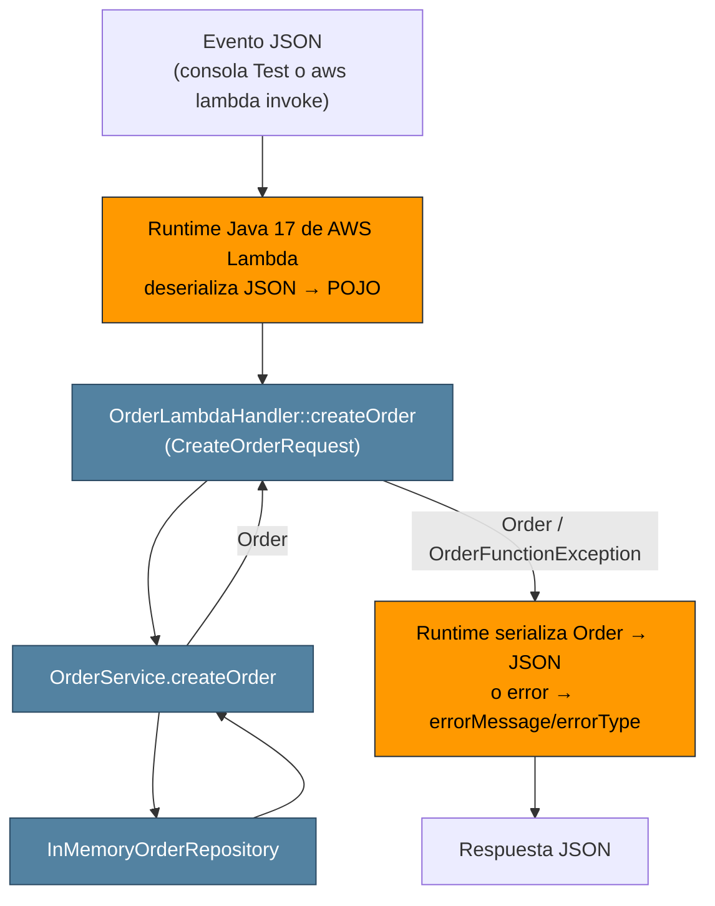

## Bitacora de decisiones del agente

| Operación | Método y URL | Parámetros | Body de entrada | Éxito | Errores |
|---|---|---|---|---|---|
| Crear orden | `POST /orders` | — | `{customerId, product, quantity}` | **201 Created** + orden creada + header `Location: /orders/{id}` | 400 `VALIDATION_ERROR`, 500 `INTERNAL_ERROR` |
| Consultar orden | `GET /orders/{id}` | path: `id` | — | **200 OK** + orden | 404 `ORDER_NOT_FOUND`, 500 |
| Buscar por cliente | `GET /orders?customerId={c}` | query: `customerId` | — | **200 OK** + lista (puede ser `[]`) | 400 si falta `customerId`, 500 |
| Eliminar orden *(Fase 7)* | `DELETE /orders/{id}` | path: `id` | — | **204 No Content** (sin body) | 404 `ORDER_NOT_FOUND`, 500 |

## Preguntas

- **Recursos:** la colección /orders y cada orden individual /orders/{id}.
- **¿Por qué /orders/{id}?** El id identifica a un recurso concreto, así que forma parte de su dirección (URI). La URL nombra una cosa.
- **¿Por qué customerId va como query param?** No identifica un recurso, sino que filtra la colección /orders. Es opcional y combinable con otros filtros (por ejemplo ?customerId=X&product=Y).
- **¿Qué devuelve POST?** 201 Created, la representación de la orden con el id generado por el servidor, y el header Location apuntando al nuevo recurso.
- **¿Y si la orden no existe?** 404 Not Found con el JSON de error. En cambio, una búsqueda por cliente sin resultados no es 404: es 200 con [], porque la colección sí existe aunque el filtro no encuentre nada.
- **¿Qué contiene un error?** Un código estable y legible por máquina (error), útil para que el cliente tome decisiones, y un mensaje legible por humanos (message). No debe incluir stack traces ni detalles internos.

## Experimento dentro de AWS

| Experimento             | Evento                                                             | Pregunta                                                          | Resultado |
|-------------------------|--------------------------------------------------------------------|-------------------------------------------------------------------|-- |
| A. Campo desconocido    | `{"customerId":"CUST-1","product":"X","quantity":1,"color":"red"}` | ¿Falla o lo ignora?                                               | Lo ignora |
| B. Tipo como string     | `{"customerId":"CUST-1","product":"X","quantity":"2"}`             | ¿Convierte `"2"` a Integer?                                       | Si convierte el `String` a `int` |
| C. Tipo incompatible    | `{"customerId":"CUST-1","product":"X","quantity":"abc"}`           | ¿Qué error da y de dónde viene: de tu código o del runtime?       | El error viene del runtime|
| D. Campo omitido        | `{"customerId":"CUST-1","product":"X"}`                            | ¿Llega `null` a tu código? (Debe responder tu `VALIDATION_ERROR`) | Sale un Error |
| E. Mayúsculas distintas | `{"CustomerId":"CUST-1","product":"X","quantity":1}`               | ¿Respeta mayúsculas y minúsculas?                                 | Si |

